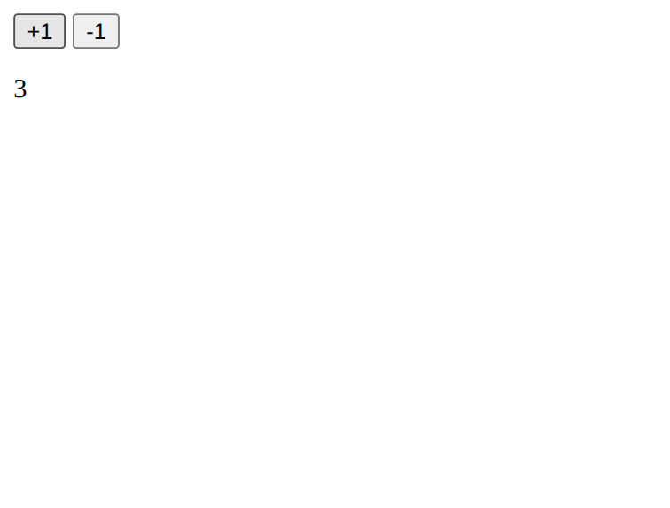

# SkillWalk

**Completed showcase: three supported tutorials and one experimental case study.**

Choose a supported tutorial, review the source-derived plan, approve once, and watch local execution, checks and bounded repairs. The supported workflows use vetted recipes; this is not arbitrary YouTube-to-software automation.

This repository is complete within that scope. No further implementation is planned here. Any future exploration of the underlying ideas will be a separate project in a new repository.

## Supported experience

1. Choose the document, presentation or frontend-design tutorial listed below. Only these three video links are executable in the web app.
2. Preview the video and compatibility notes, then confirm analysis.
3. Review the prepared example. The execution overview has a disclosed countdown with Pause and Start now; leaving it pauses approval.
4. Approve once. Work continues after viewer disconnection, with visible checks and bounded repair.
5. Explore or download the checked result. Inline edits create an unverified copy.

Local models and hardware can produce different results. A checked artifact passed its workflow's recorded tests; it is not a guarantee of exact video appearance, factual research, or general reliability.

## Featured examples and preserved baselines

| Tutorial | Earlier checked baseline | Demonstrated scope |
| --- | --- | --- |
| [Multimodal PDF questions - Nariman Codes](https://youtu.be/hBDNv47KCKo) | Local Streamlit app | Main workflow: PDF extraction, Gemma image/table descriptions, embeddings, retrieval and answers |
| [HTML presentations - Zara Zhang](https://youtu.be/372Iksaz8b0) | Five-slide HTML deck | Three cover previews, automatic selection, generation, browser tests, repairs and editing |
| [Frontend design - AI Coding Daily](https://youtu.be/DVlHZufvP10) | Local HTML/CSS homepage | Initial page, reference-guided revision, desktop/mobile checks and repairs; no Laravel/PHP backend |

The reusable PDF adapter follows the [MIT-licensed source](https://github.com/NarimanN2/ollama-playground/tree/bb2ae8d1d3665d725afd5db5df1823203002c15c/multi-modal-rag) at revision `bb2ae8d1d3665d725afd5db5df1823203002c15c`. Reviewed Python implements the workflow; Gemma interprets the source and produces configuration instructions. This is not arbitrary autonomous program synthesis or a creator-supplied Agent Skill.

The presentation uses recorded [frontend-slides](https://github.com/zarazhangrui/frontend-slides) reference material; the frontend alternative uses the video's linked [frontend-design reference](https://github.com/anthropics/claude-code/blob/main/plugins/frontend-design/skills/frontend-design/SKILL.md). Both videos demonstrate Claude. SkillWalk uses local Gemma, so appearance, quality and reliability may differ. Functional checks do not prove visual equivalence.

### Document adaptations and limits

- The video uses Gemma 3 27B; this version uses Gemma 3 4B. EmbeddingGemma replaces llama3.2 because the tested llama3.2 service did not support embeddings.
- The creator's sample PDF was unavailable. The supplied population worksheet is labelled synthetic and is not current research.
- The full HI_RES image/table workflow remains. Layout-preserving native PDF text is added, alongside local embeddings, 1000-character chunks with 200 overlap, and retrieval of up to eight chunks.
- Image descriptions can invent labels or values. A table description stays inspectable but is excluded from answers when a single detected table's labels match native text. This heuristic does not prove complete cell coverage.
- Retrieved passages fit a bounded context window. Relevant evidence can still be missed; compare answers with the PDF.

The checked runtime is local Linux/Docker. Running the downloaded Python app independently on native Windows or macOS has not been verified.

## Requirements

The host is tested on **Windows with Node.js 24**. Document processing runs in Linux containers.

- Node.js 24 and npm.
- Docker Desktop running Linux containers.
- Ollama running locally with `gemma3:4b` and `embeddinggemma`.
- `yt-dlp.exe` and `ffmpeg.exe` available on PATH. Set `YTDLP_BIN` or `FFMPEG_BIN` to their executable paths if needed.
- Internet access for initial packages, models, tutorial media and source downloads, and for the embedded YouTube player.

Model weights and generated results are not included. Setup downloads large dependencies and extraction weights; allow several minutes and enough disk space. Inference speed and memory use depend on your hardware.

## Start locally

Download or clone the project and open PowerShell in its folder. Start Docker Desktop and Ollama first. If Ollama is already running, use that service.

For a single Ollama service on its usual local port:

```powershell
ollama pull gemma3:4b
ollama pull embeddinggemma
npm ci
$env:OLLAMA_BASE = 'http://127.0.0.1:11434'
$env:OLLAMA_TEXT_BASE = 'http://127.0.0.1:11434'
$env:GEMMA_TEXT_MODEL = 'gemma3:4b'
$env:DOCUMENT_EMBEDDING_BASE = 'http://127.0.0.1:11434'
npm run setup:document
npm start
```

Open [SkillWalk](http://127.0.0.1:4179/tutorial). Stop the host with Ctrl+C.

The single-service configuration is supported by the code; the full end-to-end checks used a split profile: vision/answers with `gemma3:4b` on port 11435, and source interpretation with an existing Gemma alias `local-gemma`, plus `embeddinggemma`, on port 11434. That alias is not shipped. To use an existing split installation, set `OLLAMA_BASE`, `OLLAMA_TEXT_BASE`, `GEMMA_TEXT_MODEL` and `DOCUMENT_EMBEDDING_BASE` accordingly. Results can differ between models and configurations.

Setup builds `skillwalk-document:local` and prepares the version-matched, hash-verified browser sandbox profile. It fails explicitly if an existing profile has changed. It does not disable sandboxing or change Windows security policies. Later starts reuse the local runtime and caches.

## Fourth tutorial: experimental case study

The [Javascript Simple Counter tutorial by Timothy Unkert](https://www.youtube.com/watch?v=nkluXCISryk) is preserved as an experiment, not a fourth supported workflow. A development run executed and matched the pinned creator implementation in browser state replay. Automatic verification against the video remained unsuccessful or inconclusive.



This is a static screenshot of recorded development output, not live playback or a verified download. The UI includes the same labeled case study. It is not evidence that all open-source models are incapable: it records the limits of the tested local models, source footage, tools and implementation.

Experimental source code and its development history are preserved; arbitrary-video execution is disabled at the web API boundary. Detailed development reports and verification records are maintained privately and are not distributed with this repository.

## Local data and isolation

The host binds to `127.0.0.1:4179`; the document app is relayed at `127.0.0.1:4180`. Host, Origin and request-token checks protect local APIs. Only one job runs at a time. This is a local prototype, not an authenticated public service.

Document processing uses a nonroot, read-only container on an internal network. A restricted broker forwards approved operations to fixed local Ollama endpoints. Unrelated host folders and the Docker socket are not mounted. A host lease stops owned containers after the host disappears. Browser checks retain Chromium sandboxing, a pinned default-deny seccomp profile and bounded resources.

Runs, user PDFs, source downloads, model logs and verification evidence remain in ignored `.artifacts/`. Uploaded content can persist there after use. Do not share that directory or use sensitive PDFs unintentionally. Model inference stays local; YouTube and initial downloads still use the internet.

Downloads are gated on checked hashes. Changed files cannot silently replace a verified result. Supported presentation and frontend output checks allow an initial pass plus up to four repairs. Presentation covers allow two repairs after their initial check; document instruction repair allows two retries. Runtime failures stop explicitly.

## Verification and demonstration

Run `npm test` for the automated regression suite. At closeout, 141 regression tests passed. All three supported tutorials passed fresh local end-to-end runs with one approval, no style-choice requests, reconnect and hash-checked downloads. The frontend run needed one automatic repair for hidden desktop navigation. All 21 saved baseline artifacts remained unchanged. These are bounded local results, not hosted CI, exact video fidelity or universal model-quality claims.

For a short demonstration, show the three supported choices, run one through approval and output, then open the fourth case-study disclosure and explain why execution success was not enough to claim video fidelity. Do not present the static experimental screenshot as live execution.

## License and credits

SkillWalk's original code is [MIT licensed](LICENSE). The document adaptation retains its [upstream MIT notice](document/SOURCE-LICENSE.txt); bundled fonts retain their SIL Open Font License notices. Creator videos, source material, models and dependencies retain their own terms. Downloaded sources, private planning records and model logs are not part of the public repository.
